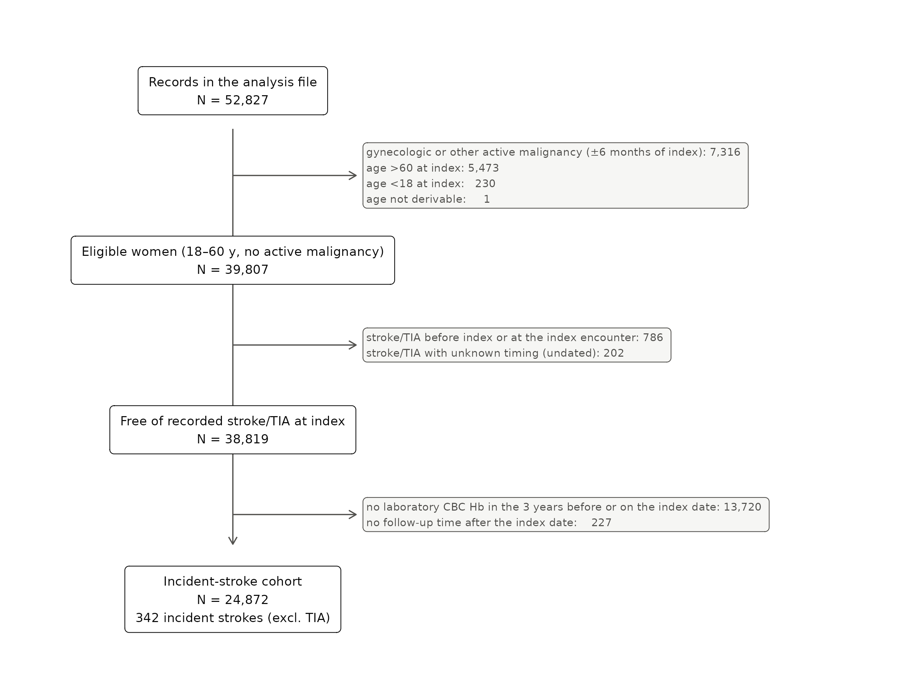
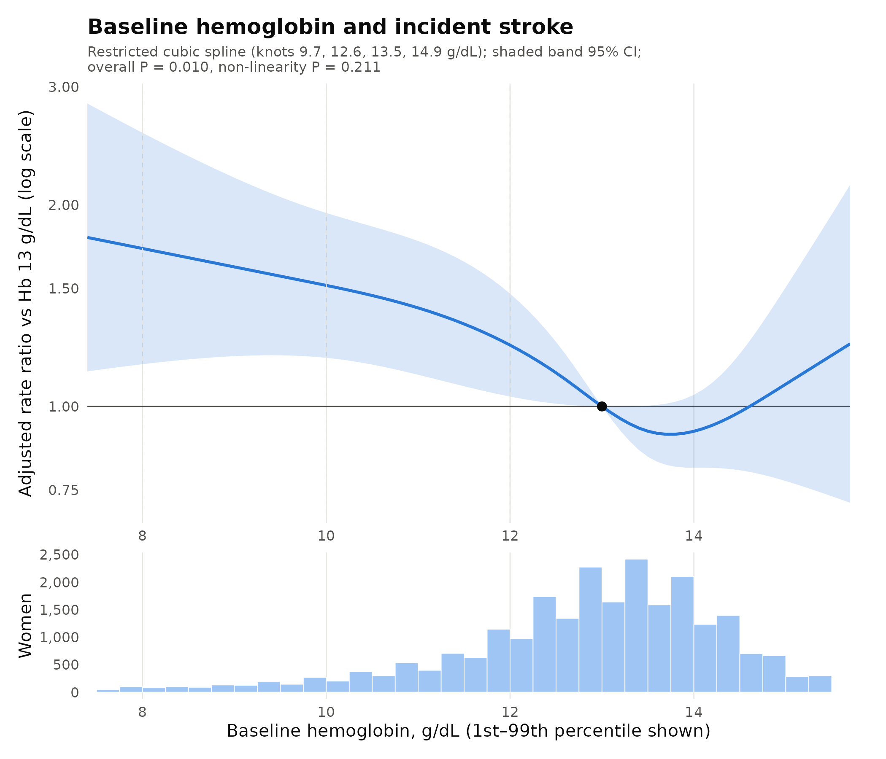
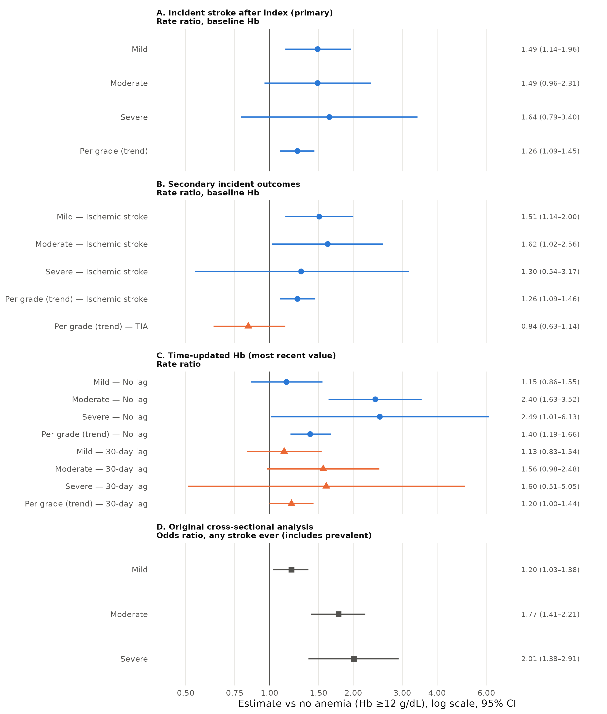
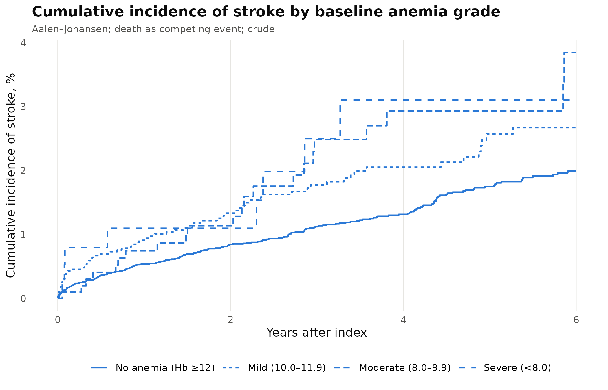

# Anemia at diagnosis of benign uterine disease and subsequent stroke: a retrospective cohort study

Running title: Anemia and incident stroke in benign uterine disease

Authors: [Author names, degrees, affiliations]  

Corresponding author: [name, address, email]

Keywords: anemia; hemoglobin; ischemic stroke; uterine fibroids; endometriosis; adenomyosis; women; cohort

_Revised draft generated by reanalysis/R/12_manuscript.R from the R outputs. Every number comes from code. [ref] marks citations to be supplied and verified; bracketed text marks information the authors must supply._

## Abstract

**Background.** Anemia is common in women with uterine fibroids, adenomyosis and endometriosis, mostly because of heavy menstrual bleeding. Whether anemia identified at diagnosis is associated with later stroke in these women is not known.

**Methods.** In a retrospective electronic-health-record cohort at one US academic center, we included women aged 18–60 years with a first diagnosis of benign uterine disease in 2018–2026 who were free of recorded stroke or transient ischemic attack (TIA) at diagnosis and had a laboratory hemoglobin (Hb) in the 3 years before or on the diagnosis date. Anemia was Hb <12 g/dL. The outcome was a first stroke (ischemic, hemorrhagic, cerebral venous thrombosis or unspecified) recorded after diagnosis; TIA was analyzed separately. Rate ratios (RR) were estimated by Poisson regression adjusted for demographic and vascular risk factors, uterine diagnosis, hormonal therapy and conditions that cause anemia. Secondary analyses updated Hb over time and examined exposure lags and testing frequency.

**Results.** Of 24,871 women (median follow-up 2.8 years), 5,471 (22.0%) were anemic. There were 342 incident strokes (298 ischemic). The stroke rate was 3.67 per 1,000 person-years without anemia and 5.79, 6.27 and 6.58 with mild, moderate and severe anemia. Anemia was associated with a higher stroke rate (adjusted RR 1.50 (1.18–1.91)); estimates by severity were 1.49 (1.14–1.96) (mild), 1.49 (0.96–2.31) (moderate) and 1.64 (0.79–3.40) (severe). Below 13 g/dL, each 1 g/dL lower Hb was associated with an RR of 1.14 (1.05–1.23). Results were similar for ischemic stroke (RR 1.52 (1.18–1.95)) and across sensitivity analyses (RR 1.38–1.57); TIA was not associated with anemia (RR 1.10 (0.66–1.81)). When Hb was updated over time, the association depended on Hb measured shortly before stroke and on how often women were tested: with a 30-day lag and adjustment for testing frequency the RR for moderate anemia was 1.20 (0.75–1.92). Stroke rates were similar whether anemia resolved or persisted (RR 0.93 (0.53–1.62)).

**Conclusions.** In women with benign uterine disease, anemia at diagnosis was associated with a modestly higher subsequent rate of recorded stroke, mainly ischemic stroke, without a clear gradient by severity. The pattern of findings suggests that anemia marks underlying illness, health-care contact and vascular risk rather than establishing an independent effect. Whether correcting anemia changes stroke risk cannot be addressed by these data.

## Introduction

Stroke in women under 60 is uncommon but causes substantial disability, and a sizeable share of events in young adults are not explained by conventional vascular risk factors [ref]. Anemia has been associated with ischemic stroke in population cohorts and case–control studies [ref]. Proposed explanations include reduced oxygen delivery, a hyperdynamic circulation, reactive thrombocytosis and a hypercoagulable state, but anemia is also a common marker of chronic illness [ref].

Women with benign uterine disease (fibroids, adenomyosis and endometriosis) are a large group with a high burden of anemia, most of it attributed to heavy menstrual bleeding [ref]. Hemoglobin is routinely measured when these conditions are diagnosed. Whether anemia at that point is associated with later stroke has not been examined. Earlier analyses of this cohort compared anemia with stroke recorded at any time; because half of those strokes preceded the gynecologic diagnosis and hemoglobin was often measured after the stroke, they could not establish the order of events. We therefore studied anemia measured before or at diagnosis and strokes recorded afterwards.

## Methods

### Design, setting and participants

This retrospective cohort study used electronic health records from a US academic medical center [site; IRB approval and waiver of consent to be added]. The index date was each woman's first recorded diagnosis of uterine fibroids, adenomyosis or endometriosis (ICD-10 codes) in an extract covering 2018–2026. Of 52,827 women, we excluded 7,316 with active malignancy within 6 months of the index date, 5,473 aged over 60, 230 aged under 18 and 1 whose age could not be derived. Of the 39,807 eligible women, we further excluded 786 with a stroke or TIA recorded before or at the index encounter and 202 whose stroke could not be dated, 13,720 with no laboratory Hb in the 3 years before or on the index date, and 227 with no follow-up after the index date (Figure 1). The study is reported according to STROBE. A statistical analysis plan was written and time-stamped before analysis.

### Exposure

Hemoglobin was taken from the laboratory results extract. We included whole-blood complete-blood-count Hb only, excluding point-of-care, blood-gas, urine and other Hb tests, implausible values (outside 3–20 g/dL) and sentinel codes; several results on one day were summarized by their median. The exposure was the most recent Hb in the 3 years up to and including the index date, so that it always preceded follow-up. Anemia was defined by the World Health Organization threshold for non-pregnant women (Hb <12 g/dL) and graded as mild (10.0–11.9 g/dL), moderate (8.0–9.9) or severe (<8.0); these bands follow the Common Terminology Criteria for Adverse Events and differ from the WHO severity bands. Hb was also analyzed as a continuous variable.

### Outcomes

Stroke and TIA were identified from diagnosis and problem-list codes, supplemented by brain-imaging reports, with the date of the earliest qualifying code. The primary outcome was a first stroke (ischemic, intracerebral or subarachnoid hemorrhage, cerebral venous thrombosis, or unspecified) dated after the index date. Each woman's stroke type was the most specific type recorded. Secondary outcomes were ischemic stroke, TIA, stroke or TIA combined, and hemorrhagic subtypes. Follow-up ended at stroke, death, last recorded contact or 25 September 2026.

### Covariates

Covariates were chosen from a causal diagram before analysis: age, race, body mass index (BMI), smoking (never, ever, unknown), hypertension, diabetes, dyslipidemia, coronary artery disease, migraine, hormonal therapy type, uterine diagnosis group, and conditions that cause anemia and are associated with stroke, each recorded on or before the index date (hemoglobinopathy, chronic kidney disease, chronic liver disease, alcohol use disorder, inflammatory bowel disease or HIV, malabsorption, and gastrointestinal bleeding or pregnancy in the preceding year). Heavy uterine bleeding was not adjusted for because it leads to anemia rather than confounding its association with stroke; thrombophilia, atrial fibrillation, heart failure and venous thromboembolism were not adjusted for in the primary model because they were undated and often recorded after a stroke. Both choices were tested in sensitivity analyses.

### Statistical analysis

Rate ratios were estimated by Poisson regression with a person-time offset and robust standard errors and confirmed by Cox regression (hazard ratios; proportional hazards assessed with Schoenfeld residuals). BMI was missing for 3.5% and was multiply imputed (20 imputations); smoking status unknown was analyzed as a category. Anemia was analyzed as any versus none, by grade, as a per-grade trend, per 1 g/dL below and above 13 g/dL, and as a restricted cubic spline (4 knots; reference 13 g/dL). Cumulative incidence was estimated with death as a competing event. Pre-specified sensitivity analyses addressed early events, exposure timing and definition, outcome misdating, adjustment choices, testing frequency, confounding by anemia-causing illness, competing death and selection into testing (inverse-probability weights). E-values described the strength of unmeasured confounding needed to explain the association. In secondary analyses, Hb was updated at every measurement (carried forward up to 1 year, never effective on its own measurement day, with time without a recent value as a separate category), with 30- and 90-day lags and adjustment for the number of Hb tests in the previous year; a landmark analysis at 12 and 24 months compared anemia that resolved with anemia that persisted. Secondary outcomes are exploratory; Benjamini–Hochberg q-values are reported for their trend tests. Analyses used R 4.3.3; code is available at [repository].

## Results

### Participants

The cohort comprised 24,871 women (Table 1), followed for 82,175 person-years (median 2.8 years, IQR 1.2–5.2). At baseline 5,471 (22.0%) were anemic: 4,008 mild, 1,062 moderate and 401 severe. Anemic women more often had fibroids, heavy bleeding, hemoglobinopathy and chronic kidney disease, and less often migraine. Women without a baseline Hb (excluded) had less recorded comorbidity and a lower crude stroke rate (2.94 vs 4.16 per 1,000 person-years; adjusted RR 0.85 (0.69–1.07)).

### Anemia and incident stroke

There were 342 incident strokes (298 ischemic, 24 intracerebral hemorrhage, 11 subarachnoid hemorrhage, 2 cerebral venous thrombosis, 7 unspecified) and 85 TIAs. The stroke rate was 3.67 (3.22–4.17) per 1,000 person-years without anemia and 5.79 (4.56–7.25), 6.27 (3.93–9.49) and 6.58 (2.84–12.96) with mild, moderate and severe anemia; 5-year cumulative incidence was 1.8%, 2.6%, 2.9% and 3.1% (Table 2, Figure S1). After adjustment, anemia was associated with a higher stroke rate (RR 1.50 (1.18–1.91); hazard ratio from the Cox model similar). By grade, RRs were 1.49 (1.14–1.96), 1.49 (0.96–2.31) and 1.64 (0.79–3.40); the per-grade trend was 1.26 (1.09–1.45). The moderate and severe estimates were based on 22 and 8 strokes. The association changed little from crude (RR 1.62 (1.29–2.04)) to fully adjusted. The E-value was 2.37 (1.64 for the confidence limit).

Below 13 g/dL, each 1 g/dL lower Hb was associated with an RR of 1.14 (1.05–1.23); above 13 g/dL the RR was 1.02 (0.85–1.23). On the spline, RRs relative to 13 g/dL were 1.23 (1.03–1.47) at 12 g/dL, 1.52 (1.18–1.94) at 10 g/dL and 1.72 (1.16–2.56) at 8 g/dL (overall P = 0.01; non-linearity P = 0.211; Figure 2).

### Secondary outcomes

Anemia was associated with ischemic stroke (RR 1.52 (1.18–1.95); per grade 1.26 (1.09–1.46)) but not with TIA (RR 1.10 (0.66–1.81); per grade 0.84 (0.63–1.14); no TIA occurred in women with moderate or severe anemia). Combining TIA with stroke gave an RR of 1.44 (1.16–1.80). Hemorrhagic subtypes were too few for reliable estimates (Table 3).

### Sensitivity analyses

The RR for any anemia ranged from 1.38 to 1.57 and the per-grade RR from 1.20 to 1.28 across sensitivity analyses (Table 4), including exclusion of strokes in the first 30 days (RR 1.38 (1.06–1.80)), restriction to Hb within 1 year (1.39 (1.07–1.80)), events with an acute stroke code (1.57 (1.23–2.01)), adjustment for testing frequency before diagnosis (1.45 (1.14–1.85)), exclusion of women with anemia-causing conditions (1.46 (1.08–1.97)) and weighting for selection into testing (per grade 1.24 (1.07–1.43)). The moderate-grade estimate ranged from 1.08 to 1.54 and its confidence interval included 1 in every analysis.

### Time-updated hemoglobin and persistence of anemia

With Hb updated over time (38,326 women; 119,305 person-years; 451 strokes), the RR for moderate anemia was 2.40 (1.63–3.52) without a lag. Person-time without a recent Hb had a lower stroke rate (RR 0.55 (0.44–0.69)), indicating that blood testing and stroke recording occur at the same encounters. With a 30-day lag the RR for moderate anemia was 1.56 (0.98–2.48), with a 90-day lag 1.57 (0.96–2.57), and with a 30-day lag plus adjustment for testing frequency 1.20 (0.75–1.92) (per grade 1.05 (0.87–1.27); Table 5). In the 12-month landmark analysis, stroke rates were similar whether baseline anemia had resolved or persisted (RR persistent vs resolved 0.93 (0.53–1.62); at 24 months 1.07 (0.58–1.98)).

### Comparison with the earlier cross-sectional analysis

Re-fitting the earlier analysis, which compared anemia with stroke or TIA recorded at any time, reproduced its estimates (odds ratios 1.20 (1.03–1.38), 1.77 (1.41–2.21) and 2.01 (1.38–2.91) for mild, moderate and severe anemia). That analysis included 786 strokes recorded before or at diagnosis and Hb values measured after the stroke, and its larger estimates for moderate and severe anemia were not seen when the order of events was enforced (Supplementary Table S2).

## Discussion

In this cohort of women with benign uterine disease, anemia at diagnosis was associated with a modestly higher rate of subsequent recorded stroke, mainly ischemic stroke. The absolute difference was small (5-year incidence 1.8% without and 2.6–3.1% with anemia). The association was consistent across sensitivity analyses addressing timing, exposure definition, outcome definition, adjustment choices and selection, but there was no clear gradient by severity, and estimates for moderate and severe anemia were imprecise.

Several findings suggest that anemia acts mainly as a marker. First, when hemoglobin was updated over time, much of the association came from values measured shortly before a recorded stroke and from how often women were tested; time without blood tests also had fewer recorded strokes, so testing and stroke recording happen together. Second, resolution of anemia was not followed by a lower stroke rate than persistence, which would be expected if low oxygen-carrying capacity itself drove risk, although these estimates were imprecise. Third, there was no gradient across grades and no association with TIA. Anemia in these women is often due to bleeding, but it also accompanies chronic kidney, liver, inflammatory and hematologic disease, and women with anemia have more contact with health services, which increases the chance that both anemia and stroke are recorded [ref]. Adjustment for, and exclusion of, recorded anemia-causing conditions did not remove the association, but undiagnosed illness and differences in care-seeking may remain; the E-value indicates that a modest unmeasured confounder could explain the lower confidence limit.

These findings temper earlier analyses of this cohort that reported larger odds ratios for moderate and severe anemia. Those analyses compared anemia with stroke recorded at any time, half of which preceded the gynecologic diagnosis, and often used hemoglobin measured after the stroke; acute illness and hospital care lower hemoglobin [ref], so that design overstates the association with severe anemia.

Clinically, anemia found at gynecologic diagnosis may prompt attention to its cause and to conventional vascular risk factors, as it would in any patient. These data do not support stroke screening based on hemoglobin, and they cannot show whether treating anemia changes stroke risk.

### Strengths and limitations

Strengths include a large cohort, a pre-specified analysis plan, laboratory values re-derived from raw dated results, dated comorbidities, a design in which exposure preceded the outcome, and extensive sensitivity analyses. Limitations are important. The study was conducted at a single center. Strokes were identified from codes and imaging reports and dated by the earliest code, not by chart review; 23 incident events rested on sequela codes or imaging alone (restricting to acute-coded events did not change the results). Women without a baseline Hb (35% of those free of stroke) differed from tested women, and their outcomes were also less completely recorded. Smoking status was unknown for 0.0% of women. Several conditions (thrombophilia, atrial fibrillation, heart failure, venous thromboembolism, migraine) and hormonal therapy were not reliably dated. Admission records, transfusions and outpatient iron prescriptions were not available. Severe anemia and hemorrhagic stroke were uncommon. The index date is the first diagnosis within records beginning in 2018.

### Conclusions

Anemia at diagnosis of benign uterine disease was associated with a modestly higher subsequent rate of recorded stroke, mainly ischemic stroke, without a clear severity gradient. The pattern suggests that anemia is a marker of underlying illness and health-care contact. Prospective studies with verified outcomes would be needed to determine whether anemia or its causes contribute to stroke risk in this population.

Acknowledgements, funding, disclosures: [to be completed]. Data availability: [statement]; analysis code: [repository].

**Table 1. Baseline characteristics by anemia grade (incident-stroke cohort)**

| Characteristic | Level | All | No anemia (Hb ≥12) | Mild (10.0–11.9) | Moderate (8.0–9.9) | Severe (<8.0) | P |
|---|---|---|---|---|---|---|---|
| Age at index, years | median (IQR) | 42.0 (34.0–48.0) | 42.0 (34.0–48.0) | 42.0 (35.0–48.0) | 43.0 (37.0–48.0) | 44.0 (38.0–48.0) | <0.001 |
| Race | White | 19,666 (79.1%) | 15,413 (79.4%) | 3,114 (77.7%) | 831 (78.2%) | 308 (76.8%) | 0.088 |
| Race | Black | 2,279 (9.2%) | 1,709 (8.8%) | 416 (10.4%) | 110 (10.4%) | 44 (11.0%) |  |
| Race | Asian | 1,314 (5.3%) | 1,016 (5.2%) | 223 (5.6%) | 52 (4.9%) | 23 (5.7%) |  |
| Race | Other/unknown | 1,613 (6.5%) | 1,263 (6.5%) | 255 (6.4%) | 69 (6.5%) | 26 (6.5%) |  |
| BMI, kg/m² | median (IQR) | 28.2 (23.9–33.8) | 28.0 (23.8–33.5) | 28.8 (24.4–34.9) | 29.3 (24.9–34.8) | 29.7 (25.1–34.5) | <0.001 |
| BMI, kg/m² | missing | 880 (3.5%) | 645 (3.3%) | 145 (3.6%) | 60 (5.6%) | 30 (7.5%) |  |
| Smoking | Never | 3,535 (14.2%) | 2,767 (14.3%) | 564 (14.1%) | 145 (13.7%) | 59 (14.7%) | 0.004 |
| Smoking | Ever | 4,876 (19.6%) | 3,895 (20.1%) | 710 (17.7%) | 212 (20.0%) | 59 (14.7%) |  |
| Smoking | Unknown | 16,461 (66.2%) | 12,739 (65.7%) | 2,734 (68.2%) | 705 (66.4%) | 283 (70.6%) |  |
| Hypertension | yes | 4,435 (17.8%) | 3,312 (17.1%) | 824 (20.6%) | 228 (21.5%) | 71 (17.7%) | <0.001 |
| Diabetes | yes | 5,592 (22.5%) | 4,275 (22.0%) | 979 (24.4%) | 267 (25.1%) | 71 (17.7%) | <0.001 |
| Dyslipidemia | yes | 12,199 (49.0%) | 9,642 (49.7%) | 1,892 (47.2%) | 514 (48.4%) | 151 (37.7%) | <0.001 |
| Coronary artery disease (before index) | yes | 380 (1.5%) | 286 (1.5%) | 68 (1.7%) | 22 (2.1%) | 4 (1.0%) | 0.265 |
| Migraine (any) | yes | 6,893 (27.7%) | 5,636 (29.1%) | 1,006 (25.1%) | 191 (18.0%) | 60 (15.0%) | <0.001 |
| Uterine diagnosis group | Fibroids only | 9,406 (37.8%) | 6,878 (35.5%) | 1,763 (44.0%) | 541 (50.9%) | 224 (55.9%) | <0.001 |
| Uterine diagnosis group | Adenomyosis only | 1,192 (4.8%) | 971 (5.0%) | 163 (4.1%) | 41 (3.9%) | 17 (4.2%) |  |
| Uterine diagnosis group | Endometriosis only | 6,368 (25.6%) | 5,444 (28.1%) | 779 (19.4%) | 120 (11.3%) | 25 (6.2%) |  |
| Uterine diagnosis group | >1 condition | 7,906 (31.8%) | 6,108 (31.5%) | 1,303 (32.5%) | 360 (33.9%) | 135 (33.7%) |  |
| Heavy/abnormal uterine bleeding | yes | 14,584 (58.6%) | 10,985 (56.6%) | 2,478 (61.8%) | 781 (73.5%) | 340 (84.8%) | <0.001 |
| Hemoglobinopathy (any date) | yes | 266 (1.1%) | 122 (0.6%) | 93 (2.3%) | 35 (3.3%) | 16 (4.0%) | <0.001 |
| CKD (before index) | yes | 671 (2.7%) | 366 (1.9%) | 197 (4.9%) | 82 (7.7%) | 26 (6.5%) | <0.001 |
| Chronic liver disease (before index) | yes | 1,360 (5.5%) | 1,071 (5.5%) | 209 (5.2%) | 64 (6.0%) | 16 (4.0%) | 0.402 |
| Any anemia-causing condition | yes | 5,830 (23.4%) | 4,165 (21.5%) | 1,251 (31.2%) | 318 (29.9%) | 96 (23.9%) | <0.001 |
| Baseline Hb, g/dL | median (IQR) | 13.1 (12.1–13.9) | 13.4 (12.8–14.1) | 11.3 (10.8–11.7) | 9.2 (8.7–9.6) | 7.1 (6.4–7.6) | <0.001 |
| Follow-up, years | median (IQR) | 2.8 (1.2–5.2) | 2.9 (1.2–5.2) | 2.8 (1.2–5.1) | 2.8 (1.2–5.3) | 2.5 (0.9–4.9) | 0.055 |
| Incident stroke (excl. TIA) | yes | 342 (1.4%) | 236 (1.2%) | 76 (1.9%) | 22 (2.1%) | 8 (2.0%) | <0.001 |
| Incident stroke or TIA | yes | 427 (1.7%) | 301 (1.6%) | 96 (2.4%) | 22 (2.1%) | 8 (2.0%) | 0.002 |
| Death without stroke | yes | 162 (0.7%) | 92 (0.5%) | 42 (1.0%) | 20 (1.9%) | 8 (2.0%) | <0.001 |

_n (%) of known values or median (IQR); P from χ² or Kruskal–Wallis tests. Full table in the supplement._

**Table 2. Baseline anemia and incident stroke (excluding TIA)**

| Baseline Hb | Women | Strokes | Person-years | Rate /1,000 PY (95% CI) | 5-y cumulative incidence, % (95% CI) | Adjusted rate ratio (95% CI) | Adjusted hazard ratio (95% CI) |
|---|---|---|---|---|---|---|---|
| No anemia (Hb ≥12) | 19400 | 236 | 64328 | 3.67 (3.22–4.17) | 1.8 (1.5–2.0) | 1.00 (reference) | 1.00 (reference) |
| Mild (10.0–11.9) | 4008 | 76 | 13123 | 5.79 (4.56–7.25) | 2.6 (2.0–3.3) | 1.49 (1.14–1.96) | 1.48 (1.14–1.94) |
| Moderate (8.0–9.9) | 1062 | 22 | 3508 | 6.27 (3.93–9.49) | 2.9 (1.9–4.6) | 1.49 (0.96–2.31) | 1.48 (0.94–2.31) |
| Severe (<8.0) | 401 | 8 | 1216 | 6.58 (2.84–12.96) | 3.1 (1.5–6.4) | 1.64 (0.79–3.40) | 1.60 (0.78–3.28) |
| Any anemia (Hb <12) |  |  |  |  |  | 1.50 (1.18–1.91) |  |
| Per grade (trend) |  |  |  |  |  | 1.26 (1.09–1.45) | 1.25 (1.08–1.45) |

_Poisson (robust SE) and Cox models adjusted for age, race, BMI, smoking, hypertension, diabetes, dyslipidemia, CAD, migraine, hormonal therapy, uterine diagnosis group and pre-index anemia-causing conditions; 20 imputations for BMI; n = 24,871. Cumulative incidence by Aalen–Johansen with death as competing event. Per 1 g/dL lower Hb below 13 g/dL: RR 1.14 (1.05–1.23)._

**Table 3. Secondary incident outcomes (exploratory)**

| Outcome | Level | Rate ratio (95% CI) | Events | Adjustment | q | Note |
|---|---|---|---|---|---|---|
| Ischemic stroke | Mild | 1.51 (1.14–2.00) | 298 | reduced pre-declared set (EPV<10 with full set) |  |  |
| Ischemic stroke | Moderate | 1.62 (1.02–2.56) | 298 | reduced pre-declared set (EPV<10 with full set) |  |  |
| Ischemic stroke | Severe | 1.30 (0.54–3.17) | 298 | reduced pre-declared set (EPV<10 with full set) |  |  |
| Ischemic stroke | Per grade (trend) | 1.26 (1.09–1.46) | 298 | reduced pre-declared set (EPV<10 with full set) | 0.011 |  |
| Ischemic stroke | Any anemia (Hb <12) | 1.52 (1.18–1.95) | 298 | reduced pre-declared set (EPV<10 with full set) |  |  |
| Stroke or TIA (Codebook stroke_any) | Mild | 1.51 (1.19–1.92) | 427 | full adjustment |  |  |
| Stroke or TIA (Codebook stroke_any) | Moderate | 1.21 (0.79–1.87) | 427 | full adjustment |  |  |
| Stroke or TIA (Codebook stroke_any) | Severe | 1.36 (0.66–2.81) | 427 | full adjustment |  |  |
| Stroke or TIA (Codebook stroke_any) | Per grade (trend) | 1.20 (1.05–1.37) | 427 | full adjustment | 0.019 |  |
| Stroke or TIA (Codebook stroke_any) | Any anemia (Hb <12) | 1.44 (1.16–1.80) | 427 | full adjustment |  |  |
| TIA | Per grade (trend) | 0.84 (0.63–1.14) | 85 | age + hypertension (few events) | 0.337 | grade categories not estimated (<5 events in a level) |
| TIA | Any anemia (Hb <12) | 1.10 (0.66–1.81) | 85 | age + hypertension (few events) |  | grade categories not estimated (<5 events in a level) |
| Intracerebral hemorrhage | Per grade (trend) | 1.59 (0.93–2.71) | 24 | age + hypertension (few events) | 0.148 | grade categories not estimated (<5 events in a level) EPV<10: unstable, exploratory |
| Intracerebral hemorrhage | Any anemia (Hb <12) | 1.46 (0.61–3.49) | 24 | age + hypertension (few events) |  | grade categories not estimated (<5 events in a level) EPV<10: unstable, exploratory |
| Subarachnoid hemorrhage | Per grade (trend) | 1.22 (0.67–2.24) | 11 | age + hypertension (few events) | 0.514 | grade categories not estimated (<5 events in a level) EPV<10: unstable, exploratory |
| Subarachnoid hemorrhage | Any anemia (Hb <12) | 2.13 (0.61–7.40) | 11 | age + hypertension (few events) |  | grade categories not estimated (<5 events in a level) EPV<10: unstable, exploratory |
| Cerebral venous thrombosis | not modeled | 2 events (<10): counts only | 2 |  |  |  |
| Stroke, unknown type | not modeled | 7 events (<10): counts only | 7 |  |  |  |

**Table 4. Sensitivity analyses (rate ratios unless stated)**

| ID | Analysis | Bias addressed | N | Events | Mild | Moderate | Severe | Per grade | Any anemia |
|---|---|---|---|---|---|---|---|---|---|
| P | Primary (MI, full adjustment) | — | 24871 | 342 | 1.49 (1.14–1.96) | 1.49 (0.96–2.31) | 1.64 (0.79–3.40) | 1.26 (1.09–1.45) | 1.50 (1.18–1.91) |
| S2 | Follow-up starts at day 31 (early events excluded) | Reverse causation / detection around the index date | 23663 | 298 | 1.36 (1.01–1.84) | 1.51 (0.95–2.40) | 1.15 (0.46–2.86) | 1.20 (1.02–1.40) | 1.38 (1.06–1.80) |
| S3 | Baseline Hb within 365 d before index | Stale exposure (Hb up to 3 y old) | 20839 | 308 | 1.36 (1.02–1.83) | 1.40 (0.88–2.21) | 1.62 (0.77–3.39) | 1.21 (1.04–1.42) | 1.39 (1.07–1.80) |
| S4 | POC Hb included in baseline Hb | Exposure definition (point-of-care values) | 23995 | 340 | 1.49 (1.13–1.95) | 1.42 (0.91–2.23) | 1.69 (0.81–3.53) | 1.25 (1.08–1.45) | 1.49 (1.16–1.90) |
| S5 | Events limited to women with ≥1 acute stroke code | Outcome misdating (history/sequela codes) | 23991 | 323 | 1.58 (1.20–2.08) | 1.54 (0.98–2.42) | 1.55 (0.71–3.35) | 1.28 (1.11–1.47) | 1.57 (1.23–2.01) |
| S6 | + heavy/abnormal uterine bleeding | Confounding vs adjustment for an exposure determinant | 24871 | 342 | 1.51 (1.15–1.98) | 1.52 (0.97–2.37) | 1.69 (0.81–3.52) | 1.27 (1.10–1.47) | 1.52 (1.19–1.94) |
| S7 | + thrombophilia, AF, heart failure, VTE (undated) | Over-adjustment check (factors possibly recorded after stroke) | 24871 | 342 | 1.48 (1.12–1.94) | 1.37 (0.87–2.15) | 1.57 (0.74–3.30) | 1.23 (1.06–1.42) | 1.46 (1.14–1.87) |
| S8 | + number of Hb tests in the 2 y before index | Healthcare contact / surveillance | 24871 | 342 | 1.45 (1.10–1.90) | 1.42 (0.91–2.21) | 1.61 (0.78–3.32) | 1.23 (1.07–1.43) | 1.45 (1.14–1.85) |
| S9 | Excluding women with any pre-index anemia-causing condition | Residual confounding by illness causing anemia | 19041 | 236 | 1.51 (1.09–2.11) | 1.08 (0.56–2.09) | 1.96 (0.84–4.61) | 1.24 (1.03–1.48) | 1.46 (1.08–1.97) |
| S10 | Fine-Gray subdistribution HR (death competing) | Competing risk of death | 23991 | 340 | 1.48 (1.13–1.94) | 1.41 (0.90–2.20) | 1.58 (0.77–3.28) | 1.24 (1.07–1.43) | not estimated |
| S11 | Inverse-probability weighted for having a baseline Hb | Selection into the tested cohort | 23991 | 340 | 1.49 (1.13–1.98) | 1.38 (0.87–2.17) | 1.55 (0.74–3.25) | 1.24 (1.07–1.43) | not estimated |

**Table 5. Time-updated hemoglobin and stroke (excluding TIA)**

| Model | Mild | Moderate | No recent Hb | Per grade (trend, measured time) | Severe |
|---|---|---|---|---|---|
| TU primary: 1-y carry-forward, no lag | 1.15 (0.86–1.55) | 2.40 (1.63–3.52) | 0.55 (0.44–0.69) | 1.40 (1.19–1.66) | 2.49 (1.01–6.13) |
| TU: + Hb tests in previous year | 1.03 (0.76–1.39) | 1.96 (1.32–2.92) | 0.60 (0.46–0.80) | 1.28 (1.08–1.52) | 2.09 (0.85–5.13) |
| TU: 3-y carry-forward (original window) | 1.16 (0.88–1.52) | 2.27 (1.57–3.28) | 1.01 (0.77–1.31) | 1.36 (1.17–1.60) | 2.13 (0.86–5.26) |
| TU: 30-day lag | 1.13 (0.83–1.54) | 1.56 (0.98–2.48) | 0.82 (0.67–1.01) | 1.20 (1.00–1.44) | 1.60 (0.51–5.05) |
| TU: 30-day lag + Hb tests in previous year | 0.96 (0.70–1.32) | 1.20 (0.75–1.92) | 1.00 (0.75–1.33) | 1.05 (0.87–1.27) | 1.26 (0.40–3.96) |
| TU: 90-day lag | 0.97 (0.69–1.36) | 1.57 (0.96–2.57) | 1.03 (0.84–1.27) | 1.19 (0.97–1.45) | 2.28 (0.85–6.15) |

_Most recent laboratory Hb, carried forward up to 1 year (3 years in the last row); never effective on its measurement day; Poisson with SE clustered by woman, full adjustment, 20 imputations._

## Figures

